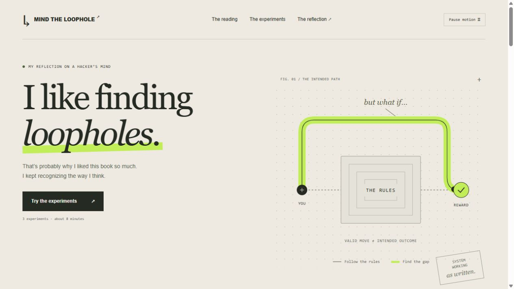

# ↳ Mind the Loophole

**A playable reflection on *A Hacker’s Mind* by Bruce Schneier.**

AIPI 590: Explainable AI

> I like finding loopholes. That’s probably why I liked this book so much.

I read a hard copy of the book and wanted to turn some of its ideas into games. I used code to explore why gaming a score can be tempting, how money helps people use loopholes, and what has to happen for hacking to make a system stronger. I also connected these examples to Explainable AI.

**Start here:** run the website using the instructions below. For a reading-only version directly on GitHub, open [REFLECTION.md](REFLECTION.md).



## Run locally

Requires **Node.js 20 or newer**. There are **no packages to install**, API keys, or accounts.

Clone the repository and start it:

```sh
git clone https://github.com/konurnordberg/Hacker-s-Mind-Book-Club-Reflection.git
cd Hacker-s-Mind-Book-Club-Reflection
node scripts/serve.mjs
```

If you downloaded a ZIP instead, extract it, open a terminal in that folder, and run `node scripts/serve.mjs`.

Visit **http://127.0.0.1:4173** in your browser. Stop the server with **Ctrl+C**.

If you have npm, `npm start` does the same thing. If the port is busy:

```sh
node scripts/serve.mjs --port 4174
```

Then visit http://127.0.0.1:4174. Use the server instead of double-clicking `index.html`; browser module imports need HTTP.

## The experience

| Experiment | What to try | What it asks |
| --- | --- | --- |
| **The perfect score** | Write one note, resubmit it four times, then patch the scoring rule. | Does a transparent explanation prove that the objective is sensible? |
| **The unequal loophole** | Add resources and accounts, then switch the cap from accounts to people. | Who can afford to exploit a rule, and who bears the cost? |
| **The pressure test** | Run with repair off, then repeat at the same pressure with repair on. | What has to happen between exposing a weakness and making a system stronger? |

Allow about eight minutes to read and try the experiments. Each one includes my thoughts on what happens. The final section covers what I took from the book and how it relates to Explainable AI.

I made these simplified models to explore the ideas in the book. The rules are shown in each game and explained in the code comments.

## Optional: GitHub Pages

The repository can be downloaded and run locally without enabling Pages. To host the interactive reflection in a browser:

1. In this repository, open **Settings → Pages → Build and deployment → Source**, and select **GitHub Actions**.
2. Open **Actions → Test and publish reflection → Run workflow**, select `main`, and run it.
3. Wait for the deployment to succeed. The live URL appears in **Settings → Pages** and in the deployment job.
4. Open that URL in a private browser window to verify public access.

Run the publishing workflow again when you want to update the hosted page. Pushes and pull requests run the separate test/build workflow automatically.

## Check and build

```sh
node --test
node scripts/build.mjs
node scripts/serve.mjs --dist
```

The 15 tests check the exploit, patch behavior, resource limits, money conservation, pressure outcomes, JavaScript syntax, and page wiring. [VALIDATION.md](VALIDATION.md) records the browser checks and remaining verification limits. The build copies only public assets into `dist/`.

## Project map

```text
index.html                 Essay, accessible controls, and SVG illustrations
styles.css                 Responsive design, animations, print/reduced-motion styles
src/models.js              Pure, commented simulation rules
src/app.js                 Interaction, chart updates, local notes, text export
assets/favicon.svg         Original vector mark
scripts/serve.mjs           Local HTTP server (Node built-ins only)
scripts/build.mjs           Static deployment builder
tests/                     Model and page-contract checks
.github/workflows/ci.yml    Test and build on pushes and pull requests
.github/workflows/pages.yml  Optional manual GitHub Pages deployment
REFLECTION.md              Reading-only reflection for GitHub
```

## Access and privacy

- Keyboard-operable tabs (arrows, Home, End), native controls, focus indicators, and a skip link.
- Respects reduced-motion settings; a motion button pauses animation.
- Mobile layouts and print styles; the essay remains readable without JavaScript.
- Optional margin notes and motion preferences stay in browser local storage. Notes can be exported as plain text.
- No analytics, cookies, sign-in, external fonts, runtime network requests, or backend. Reloading resets the experiments.
